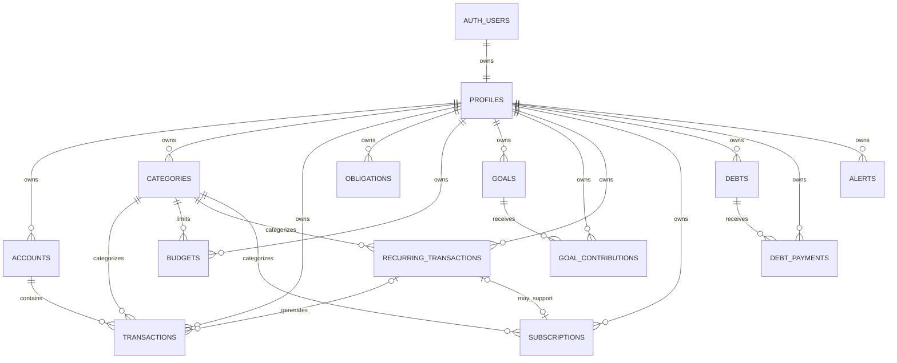

# FinWise — Modelo de Datos y Seguridad

> Especificación canónica del modelo de datos, integridad y seguridad de FinWise.
>
> Ubicación: `contexto/arquitectura/MODELO_DATOS_Y_SEGURIDAD.md`
>
> Estado: **Modelo base aprobado para implementación**
>
> Fecha de referencia: **7 de octubre de 2026**
>
> Depende de:
> - `contexto/FINWISE_CONTEXTO_MAESTRO.md`
> - `contexto/arquitectura/ARQUITECTURA_TECNICA.md`

---

# 1. Propósito

Este documento define:

- entidades persistentes;
- relaciones;
- ownership;
- tipos PostgreSQL;
- precisión monetaria;
- integridad referencial;
- soft-delete;
- índices;
- relación entre Supabase Auth y datos de aplicación;
- Row Level Security (RLS);
- privilegios;
- estrategia de migraciones;
- datos derivados;
- datos que **no** deben persistirse;
- reglas para evitar acceso cruzado entre usuarios.

Este documento será la fuente de verdad para crear las migraciones de Supabase.

No crear tablas o columnas nuevas que contradigan este archivo sin actualizar primero el modelo o registrar una decisión arquitectónica.

---

# 2. Principios del modelo

## 2.1 PostgreSQL es la fuente de verdad persistente

Los datos financieros persistentes viven en Supabase PostgreSQL.

La UI no debe convertirse en una segunda fuente de verdad.

---

## 2.2 Los datos derivados no se persisten inicialmente

No guardar valores que puedan calcularse de forma confiable a partir de otros registros salvo que exista una necesidad de rendimiento demostrada.

Ejemplos inicialmente derivados:

- saldo actual de una cuenta;
- saldo líquido global;
- crédito disponible;
- total gastado de un presupuesto;
- porcentaje consumido;
- monto actual de una meta;
- tasa de ahorro;
- dinero disponible;
- forecast;
- Financial Score;
- métricas del dashboard.

Esto evita inconsistencias entre el ledger y campos calculados.

---

## 2.3 Toda información privada tiene propietario

Toda entidad financiera perteneciente a un usuario debe incluir:

```text
user_id uuid
```

y el valor debe coincidir con el usuario autenticado.

RLS es una barrera obligatoria, no una optimización.

---

## 2.4 Defensa en profundidad

La separación entre usuarios se protege mediante varias capas:

```text
Supabase Auth
      ↓
Application authorization
      ↓
user_id
      ↓
Composite foreign keys
      ↓
RLS
      ↓
PostgreSQL constraints
```

Una sola capa no debe ser responsable de toda la seguridad.

---

# 3. Decisiones que refinan el contexto maestro

El contexto maestro contiene un modelo conceptual. Este documento lo convierte en un modelo implementable y toma las siguientes decisiones.

## 3.1 `User` pasa a ser `auth.users + profiles`

No crear una tabla `users` que replique Supabase Auth.

Usar:

```text
auth.users
   1
   │
   1
public.profiles
```

`auth.users` administra identidad.

`public.profiles` administra configuración de FinWise.

---

## 3.2 Se agrega `obligations`

El MVP académico requiere que el usuario pueda definir obligaciones pendientes.

El modelo conceptual original no tenía una entidad específica.

Se agrega:

```text
public.obligations
```

para representar compromisos financieros pendientes.

En el MVP su origen será manual.

En versiones futuras podrá registrar obligaciones originadas por:

- suscripciones;
- recurrencias;
- otras fuentes controladas.

---

## 3.3 `Account.currentBalance` no se persiste inicialmente

Se reemplaza por un cálculo basado en:

```text
opening_balance
+
movimientos
```

Esto evita mantener dos fuentes de verdad.

Si posteriormente el volumen exige optimización, podrán incorporarse snapshots o agregados mediante ADR.

---

## 3.4 `Goal.currentAmount` no se persiste inicialmente

Se calcula:

```text
currentAmount =
initial_amount
+
sum(goal_contributions)
```

---

## 3.5 Los presupuestos usan `period_month`

En lugar de almacenar `month` y `year` de forma independiente se utilizará:

```text
period_month DATE
```

siempre representando el primer día del mes.

Ejemplo:

```text
2026-10-01
```

Esto simplifica restricciones y consultas.

---

## 3.6 Las transacciones tienen `direction`

Además de:

```text
INCOME
EXPENSE
TRANSFER
```

se almacenará la dirección relativa a la cuenta:

```text
INFLOW
OUTFLOW
```

Reglas:

```text
INCOME  → INFLOW
EXPENSE → OUTFLOW
TRANSFER → INFLOW u OUTFLOW
```

Esto permite modelar correctamente:

- transferencias;
- cuentas de activos;
- tarjetas de crédito.

---

## 3.7 Eliminación de transacciones

La acción de usuario "eliminar transacción" se implementará inicialmente mediante soft-delete:

```text
deleted_at
```

No se destruye inmediatamente el historial financiero.

---

# 4. Esquemas PostgreSQL

FinWise utilizará principalmente:

```text
auth
public
private
```

## `auth`

Administrado por Supabase.

No modificar directamente las tablas de Auth.

---

## `public`

Contiene datos de aplicación accesibles mediante Data API y protegidos por RLS.

---

## `private`

Reservado para:

- funciones internas;
- helpers de seguridad;
- procesos que no deben exponerse mediante Data API.

No crear objetos en `private` si no existe una necesidad real.

---

# 5. Convenciones generales

## 5.1 Nombres

PostgreSQL:

```text
snake_case
```

TypeScript:

```text
camelCase
```

El repository/mapping layer realiza la conversión cuando sea necesaria.

---

## 5.2 Primary keys

Usar:

```text
uuid
```

con:

```sql
gen_random_uuid()
```

excepto `profiles.id`, que será el mismo UUID de `auth.users.id`.

---

## 5.3 Fechas técnicas

Usar:

```text
timestamptz
```

para:

- `created_at`;
- `updated_at`;
- `deleted_at`;
- `read_at`;
- eventos técnicos.

---

## 5.4 Fechas financieras

Usar:

```text
date
```

cuando la hora no sea parte del significado financiero.

Ejemplos:

- transaction_date;
- contribution_date;
- due_date;
- target_date;
- next_payment_date.

---

## 5.5 Timestamps base

Las tablas persistentes relevantes incluirán:

```text
created_at timestamptz not null default now()
updated_at timestamptz not null default now()
```

`updated_at` será mantenido por un trigger reutilizable.

---

# 6. Estrategia monetaria definitiva

## 6.1 PostgreSQL

Los importes monetarios se almacenarán como:

```text
numeric(20,4)
```

No utilizar:

```text
real
double precision
money
```

para cálculos financieros críticos.

---

## 6.2 Motivo

`numeric` permite cálculos decimales exactos en PostgreSQL.

Cuatro decimales permiten:

- COP;
- monedas con centavos;
- cálculos internos;
- tasas/conversiones futuras con precisión adicional.

---

## 6.3 TypeScript

En lógica crítica utilizar representación decimal exacta.

Decisión inicial:

```text
decimal.js
```

No realizar cálculos financieros utilizando directamente `number`.

Ejemplo conceptual:

```text
DB NUMERIC
   ↓
Repository
   ↓
Decimal
   ↓
Domain calculation
   ↓
Decimal/string
   ↓
View Model
```

---

## 6.4 Frontera servidor/cliente

Los valores monetarios que crucen una frontera serializable deben transportarse preferiblemente como:

```text
string decimal
```

Ejemplo:

```json
{
  "availableToSpend": "1250000.0000"
}
```

La conversión a `number` se permite únicamente para presentación cuando no afecta el cálculo fuente.

---

## 6.5 Moneda

Cada entidad monetaria relevante incluirá:

```text
currency_code varchar(3)
```

Inicialmente:

```text
COP
```

Regla:

```text
^[A-Z]{3}$
```

No realizar sumas entre monedas diferentes sin una conversión explícita.

---

# 7. Relación Auth ↔ Profile

```text
auth.users
   │
   │ 1 : 1
   ▼
public.profiles
```

## `profiles`

| Campo | Tipo | Regla |
|---|---|---|
| id | uuid | PK, FK → `auth.users.id`, ON DELETE CASCADE |
| display_name | text | nullable |
| currency_code | varchar(3) | NOT NULL, default `COP` |
| timezone | text | NOT NULL, default `America/Bogota` |
| safety_reserve | numeric(20,4) | NOT NULL, default 0, >= 0 |
| locale | text | NOT NULL, default `es-CO` |
| created_at | timestamptz | NOT NULL |
| updated_at | timestamptz | NOT NULL |

No almacenar email duplicado en `profiles`.

El email pertenece a Supabase Auth.

---

# 8. Creación automática del profile

Al crear un usuario en `auth.users`, se debe crear su `profiles`.

Se utilizará un trigger probado mediante migración.

Reglas:

- la función debe tener una implementación mínima;
- utilizar nombres de esquema explícitos;
- no realizar llamadas externas;
- cualquier error del trigger puede impedir el signup;
- incluir prueba automatizada del flujo.

La aplicación no dependerá de que el navegador cree el profile después del signup.

---

# 9. Ownership base

Las tablas financieras tendrán:

```text
user_id uuid not null
references public.profiles(id)
on delete cascade
```

Esto permite:

```text
auth.users
   ↓ cascade
profiles
   ↓ cascade
financial data
```

La eliminación definitiva de una cuenta de usuario se implementará mediante un flujo privilegiado y explícito, no mediante `DELETE profiles` desde el cliente.

---

# 10. Diagrama entidad-relación



---

# 11. Tipos de dominio persistentes

Valores conceptuales.

## AccountType

```text
CASH
CHECKING
SAVINGS
CREDIT_CARD
DIGITAL_WALLET
OTHER
```

---

## CategoryType

```text
INCOME
EXPENSE
```

---

## TransactionType

```text
INCOME
EXPENSE
TRANSFER
```

---

## TransactionDirection

```text
INFLOW
OUTFLOW
```

---

## GoalStatus

```text
ACTIVE
COMPLETED
PAUSED
CANCELLED
```

---

## ObligationStatus

```text
PENDING
PAID
CANCELLED
```

---

## ObligationSource

```text
MANUAL
SUBSCRIPTION
RECURRING
OTHER
```

---

## RecurringStatus

```text
ACTIVE
PAUSED
CANCELLED
```

---

## Frequency

```text
WEEKLY
MONTHLY
QUARTERLY
YEARLY
CUSTOM
```

---

## DebtType

```text
CREDIT_CARD
PERSONAL_LOAN
STUDENT_LOAN
MORTGAGE
OTHER
```

---

## DebtStatus

```text
ACTIVE
PAID
PAUSED
CANCELLED
```

---

## AlertSeverity

```text
INFO
WARNING
CRITICAL
SUCCESS
```

---

# 12. Accounts

Representa dónde existe dinero o una obligación de crédito.

## Campos

| Campo | Tipo | Regla |
|---|---|---|
| id | uuid | PK |
| user_id | uuid | NOT NULL, ownership |
| name | text | NOT NULL |
| type | account_type | NOT NULL |
| opening_balance | numeric(20,4) | NOT NULL default 0 |
| currency_code | varchar(3) | NOT NULL default COP |
| color | text | nullable |
| icon | text | nullable |
| credit_limit | numeric(20,4) | nullable |
| payment_due_day | smallint | nullable, 1..31 |
| statement_closing_day | smallint | nullable, 1..31 |
| is_archived | boolean | NOT NULL default false |
| deleted_at | timestamptz | nullable |
| created_at | timestamptz | NOT NULL |
| updated_at | timestamptz | NOT NULL |

---

## 12.1 Semántica de `opening_balance`

Para cuentas de activos:

```text
saldo inicial disponible
```

Para `CREDIT_CARD`:

```text
deuda existente al comenzar a usar FinWise
```

---

## 12.2 Saldo actual

No existe una columna `current_balance`.

Para una cuenta de activos:

```text
balance =
opening_balance
+ inflows
- outflows
```

Para una tarjeta:

```text
current_debt =
opening_balance
+ outflows
- inflows
```

---

## 12.3 Crédito disponible

Derivado:

```text
available_credit =
credit_limit
- current_debt
```

Nunca incluir `available_credit` dentro de `saldoLiquido`.

---

## 12.4 Constraints

- nombre no vacío;
- `currency_code` válido;
- `credit_limit > 0` cuando exista;
- `payment_due_day` entre 1 y 31;
- `statement_closing_day` entre 1 y 31;
- si `type != CREDIT_CARD`, los campos específicos de tarjeta deben ser `NULL` inicialmente.

---

# 13. Categories

## Campos

| Campo | Tipo | Regla |
|---|---|---|
| id | uuid | PK |
| user_id | uuid | NOT NULL |
| name | text | NOT NULL |
| type | category_type | NOT NULL |
| icon | text | nullable |
| color | text | nullable |
| is_default | boolean | NOT NULL default false |
| deleted_at | timestamptz | nullable |
| created_at | timestamptz | NOT NULL |
| updated_at | timestamptz | NOT NULL |

No compartir inicialmente una misma fila de categoría entre usuarios.

Al crear un perfil se podrán insertar categorías predeterminadas pertenecientes a ese usuario.

---

## 13.1 Unicidad

No permitir dos categorías activas con mismo:

```text
user_id
type
lower(name)
```

Utilizar índice único parcial con:

```text
deleted_at is null
```

---

# 14. Transactions

Es el ledger principal de FinWise.

## Campos

| Campo | Tipo | Regla |
|---|---|---|
| id | uuid | PK |
| user_id | uuid | NOT NULL |
| account_id | uuid | NOT NULL |
| category_id | uuid | nullable para transferencias |
| type | transaction_type | NOT NULL |
| direction | transaction_direction | NOT NULL |
| amount | numeric(20,4) | NOT NULL, > 0 |
| currency_code | varchar(3) | NOT NULL |
| description | text | NOT NULL |
| transaction_date | date | NOT NULL |
| notes | text | nullable |
| recurring_transaction_id | uuid | nullable |
| transfer_group_id | uuid | nullable |
| deleted_at | timestamptz | nullable |
| created_at | timestamptz | NOT NULL |
| updated_at | timestamptz | NOT NULL |

---

# 15. Reglas de Transaction

## Income

```text
type = INCOME
direction = INFLOW
category.type = INCOME
```

---

## Expense

```text
type = EXPENSE
direction = OUTFLOW
category.type = EXPENSE
```

---

## Transfer

```text
type = TRANSFER
category_id = NULL
transfer_group_id != NULL
```

Un transfer normal genera dos registros.

Origen:

```text
TRANSFER + OUTFLOW
```

Destino:

```text
TRANSFER + INFLOW
```

---

# 16. Transferencias V1

La primera versión soportará transferencias entre cuentas de la misma moneda.

Reglas:

```text
same user
same currency
same amount
same transfer_group_id
exactly two active rows
one INFLOW
one OUTFLOW
different accounts
```

Una transferencia:

```text
no aumenta ingresos
no aumenta gastos
```

El soporte de transferencias con cambio de moneda requerirá una extensión posterior.

---

# 17. Integridad multiusuario reforzada

Además de RLS se utilizarán claves foráneas compuestas cuando una entidad hija referencia otra entidad del usuario.

Ejemplo conceptual:

```text
transactions(account_id, user_id)
        ↓
accounts(id, user_id)
```

Esto impide asociar accidentalmente una transacción del usuario A con una cuenta del usuario B incluso si existe un error en código privilegiado.

Aplicar este patrón a:

- transaction → account;
- transaction → category;
- budget → category;
- contribution → goal;
- recurring → account;
- recurring → category;
- subscription → category;
- debt_payment → debt.

Las tablas padre deberán exponer una restricción `UNIQUE(id, user_id)` para habilitar estas FK compuestas.

---

# 18. Obligations

Representa dinero que el usuario ya considera comprometido y pendiente.

Es fundamental para el MVP académico.

## Campos

| Campo | Tipo | Regla |
|---|---|---|
| id | uuid | PK |
| user_id | uuid | NOT NULL |
| name | text | NOT NULL |
| description | text | nullable |
| amount | numeric(20,4) | NOT NULL, > 0 |
| currency_code | varchar(3) | NOT NULL |
| due_date | date | NOT NULL |
| status | obligation_status | NOT NULL default PENDING |
| source | obligation_source | NOT NULL default MANUAL |
| source_id | uuid | nullable |
| paid_at | timestamptz | nullable |
| deleted_at | timestamptz | nullable |
| created_at | timestamptz | NOT NULL |
| updated_at | timestamptz | NOT NULL |

---

# 19. Regla de obligaciones

En el MVP:

```text
source = MANUAL
```

Versiones posteriores podrán generar instancias de obligación desde recurrencias o suscripciones.

El cálculo de dinero disponible debe evitar contar dos veces la misma obligación.

Cuando exista una obligación generada desde otra entidad, el cálculo usará la instancia de `obligations` como compromiso pendiente y no volverá a sumar su fuente de forma independiente.

---

# 20. Dinero disponible

El dominio conservará el concepto:

```text
dineroDisponible =
saldoLiquido
- obligacionesPendientes
- metasAhorroComprometidas
- pagosDeudaPendientes
- reservaSeguridad
```

Sin embargo, el application service será responsable de ensamblar datos sin duplicaciones.

Para el MVP:

```text
dineroDisponibleMVP =
saldoLiquido
- obligacionesPendientes
- reservaSeguridad
```

---

# 21. Budgets

## Campos

| Campo | Tipo | Regla |
|---|---|---|
| id | uuid | PK |
| user_id | uuid | NOT NULL |
| category_id | uuid | NOT NULL |
| period_month | date | NOT NULL, primer día del mes |
| limit_amount | numeric(20,4) | NOT NULL, > 0 |
| currency_code | varchar(3) | NOT NULL |
| created_at | timestamptz | NOT NULL |
| updated_at | timestamptz | NOT NULL |

---

## 21.1 Unicidad

```text
unique(user_id, category_id, period_month)
```

---

## 21.2 Gasto consumido

No persistir.

Derivar:

```text
spent =
sum(EXPENSE transactions)
```

filtrando por:

- usuario;
- categoría;
- periodo;
- `deleted_at IS NULL`.

---

# 22. Goals

## Campos

| Campo | Tipo | Regla |
|---|---|---|
| id | uuid | PK |
| user_id | uuid | NOT NULL |
| name | text | NOT NULL |
| description | text | nullable |
| target_amount | numeric(20,4) | NOT NULL, > 0 |
| initial_amount | numeric(20,4) | NOT NULL default 0 |
| monthly_commitment_amount | numeric(20,4) | NOT NULL default 0 |
| currency_code | varchar(3) | NOT NULL |
| target_date | date | nullable |
| status | goal_status | NOT NULL default ACTIVE |
| deleted_at | timestamptz | nullable |
| created_at | timestamptz | NOT NULL |
| updated_at | timestamptz | NOT NULL |

---

# 23. Monto actual de meta

Derivado:

```text
current_amount =
initial_amount
+
sum(active goal_contributions)
```

---

# 24. Ahorro mensual recomendado

No persistir.

Derivar:

```text
remaining =
target_amount - current_amount

recommended_monthly_saving =
remaining / months_remaining
```

`monthly_commitment_amount` representa lo que el usuario se compromete a separar, no la recomendación calculada.

---

# 25. Goal Contributions

## Campos

| Campo | Tipo | Regla |
|---|---|---|
| id | uuid | PK |
| user_id | uuid | NOT NULL |
| goal_id | uuid | NOT NULL |
| amount | numeric(20,4) | NOT NULL, > 0 |
| contribution_date | date | NOT NULL |
| notes | text | nullable |
| created_at | timestamptz | NOT NULL |
| updated_at | timestamptz | NOT NULL |

FK compuesta:

```text
(goal_id, user_id)
→ goals(id, user_id)
```

---

# 26. Recurring Transactions

## Campos

| Campo | Tipo | Regla |
|---|---|---|
| id | uuid | PK |
| user_id | uuid | NOT NULL |
| name | text | NOT NULL |
| type | category_type | INCOME o EXPENSE |
| amount | numeric(20,4) | NOT NULL, > 0 |
| currency_code | varchar(3) | NOT NULL |
| category_id | uuid | NOT NULL |
| account_id | uuid | NOT NULL |
| frequency | frequency | NOT NULL |
| custom_interval_days | smallint | nullable |
| next_execution_date | date | NOT NULL |
| is_automatic | boolean | NOT NULL default false |
| status | recurring_status | NOT NULL default ACTIVE |
| deleted_at | timestamptz | nullable |
| created_at | timestamptz | NOT NULL |
| updated_at | timestamptz | NOT NULL |

---

## 26.1 Significado de `is_automatic`

Nunca significa ejecutar pagos externos.

Solo podrá significar en una versión futura:

> crear automáticamente un registro financiero interno en FinWise.

FinWise no ejecuta transferencias bancarias reales.

---

# 27. Subscriptions

## Campos

| Campo | Tipo | Regla |
|---|---|---|
| id | uuid | PK |
| user_id | uuid | NOT NULL |
| name | text | NOT NULL |
| amount | numeric(20,4) | NOT NULL, > 0 |
| currency_code | varchar(3) | NOT NULL |
| category_id | uuid | nullable |
| recurring_transaction_id | uuid | nullable |
| frequency | frequency | NOT NULL |
| custom_interval_days | smallint | nullable |
| next_payment_date | date | NOT NULL |
| status | recurring_status | NOT NULL default ACTIVE |
| source | text | NOT NULL default MANUAL |
| deleted_at | timestamptz | nullable |
| created_at | timestamptz | NOT NULL |
| updated_at | timestamptz | NOT NULL |

Una suscripción puede estar vinculada a una recurrencia, pero no es obligatorio.

---

# 28. Debts

## Campos

| Campo | Tipo | Regla |
|---|---|---|
| id | uuid | PK |
| user_id | uuid | NOT NULL |
| name | text | NOT NULL |
| type | debt_type | NOT NULL |
| original_amount | numeric(20,4) | NOT NULL, > 0 |
| current_balance | numeric(20,4) | NOT NULL, >= 0 |
| interest_rate_percent | numeric(7,4) | NOT NULL default 0 |
| minimum_payment | numeric(20,4) | NOT NULL default 0 |
| payment_day | smallint | nullable, 1..31 |
| currency_code | varchar(3) | NOT NULL |
| status | debt_status | NOT NULL default ACTIVE |
| deleted_at | timestamptz | nullable |
| created_at | timestamptz | NOT NULL |
| updated_at | timestamptz | NOT NULL |

---

# 29. Por qué `Debt.current_balance` sí se persiste

A diferencia de una cuenta simple, una deuda puede cambiar por:

- intereses;
- ajustes;
- comisiones;
- información externa;
- refinanciación.

Por ello `current_balance` será el saldo declarado/actual del pasivo.

Los pagos deben actualizar:

```text
debt_payments
+
debts.current_balance
```

de forma atómica cuando esa funcionalidad sea implementada.

---

# 30. Debt Payments

## Campos

| Campo | Tipo | Regla |
|---|---|---|
| id | uuid | PK |
| user_id | uuid | NOT NULL |
| debt_id | uuid | NOT NULL |
| amount | numeric(20,4) | NOT NULL, > 0 |
| principal_amount | numeric(20,4) | NOT NULL, >= 0 |
| interest_amount | numeric(20,4) | NOT NULL, >= 0 |
| payment_date | date | NOT NULL |
| notes | text | nullable |
| created_at | timestamptz | NOT NULL |

Constraint:

```text
principal_amount + interest_amount = amount
```

FK compuesta:

```text
(debt_id, user_id)
→ debts(id, user_id)
```

---

# 31. Alerts

## Campos

| Campo | Tipo | Regla |
|---|---|---|
| id | uuid | PK |
| user_id | uuid | NOT NULL |
| type | text | NOT NULL |
| title | text | NOT NULL |
| message | text | NOT NULL |
| severity | alert_severity | NOT NULL |
| is_read | boolean | NOT NULL default false |
| read_at | timestamptz | nullable |
| metadata | jsonb | NOT NULL default `{}` |
| dedup_key | text | nullable |
| expires_at | timestamptz | nullable |
| created_at | timestamptz | NOT NULL |

---

## 31.1 `metadata`

No usar `metadata` como sustituto de columnas importantes.

Solo almacenar contexto auxiliar.

No incluir secretos ni información financiera sensible innecesaria.

---

## 31.2 Deduplicación

Cuando una alerta pueda generarse repetidamente:

```text
unique(user_id, dedup_key)
where dedup_key is not null
```

El diseño exacto podrá incorporar periodo/estado si una alerta debe reaparecer posteriormente.

---

# 32. Datos que no requieren tabla inicialmente

No crear tablas para:

## Dashboard summary

Derivado.

## Available to spend

Derivado.

## Forecast

Derivado.

## Financial Score

Derivado.

## Savings rate

Derivado.

## Net cash flow

Derivado.

## Monthly analysis

Derivado.

Persistir estos resultados solo si mediciones reales justifican snapshots/agregaciones.

---

# 33. Soft-delete

Usar inicialmente `deleted_at` en:

- accounts;
- categories;
- transactions;
- obligations;
- goals;
- recurring_transactions;
- subscriptions;
- debts.

La capa de repositorio debe filtrar:

```text
deleted_at IS NULL
```

por defecto.

---

# 34. Hard-delete

No exponer hard-delete normal sobre:

- accounts;
- categories;
- transactions.

Para entidades históricas importantes preferir archivado o soft-delete.

La eliminación definitiva del usuario completo constituye un flujo separado.

---

# 35. Updated At

Crear una función reutilizable para `updated_at`.

Conceptualmente:

```sql
create function private.set_updated_at()
returns trigger
language plpgsql
security invoker
set search_path = ''
as $$
begin
  new.updated_at = now();
  return new;
end;
$$;
```

Aplicar a tablas que tengan `updated_at`.

---

# 36. Row Level Security

RLS debe estar habilitado en **todas** las tablas de aplicación expuestas.

Ejemplo:

```sql
alter table public.accounts enable row level security;
```

No crear una tabla en `public` y dejar la activación de RLS para una migración futura.

Tabla + grants + RLS + políticas mínimas deben salir juntas.

---

# 37. Política RLS base

Para tablas con `user_id`:

## SELECT

```sql
using (
  (select auth.uid()) = user_id
)
```

## INSERT

```sql
with check (
  (select auth.uid()) = user_id
)
```

## UPDATE

```sql
using (
  (select auth.uid()) = user_id
)
with check (
  (select auth.uid()) = user_id
)
```

Aplicar:

```text
TO authenticated
```

No usar una política genérica `FOR ALL` por defecto.

Crear políticas separadas por operación.

---

# 38. Profiles RLS

Como:

```text
profiles.id = auth.uid()
```

## SELECT

Usuario puede consultar su propio profile.

## UPDATE

Usuario puede actualizar su propio profile.

## INSERT

No conceder al cliente.

El profile lo crea el trigger de signup.

## DELETE

No conceder al cliente.

La eliminación de cuenta se ejecuta mediante flujo dedicado.

---

# 39. DELETE policies

No crear políticas DELETE cuando la operación del producto sea soft-delete.

En esos casos, el usuario ejecuta un UPDATE de `deleted_at`.

Para entidades que sí permitan eliminación física futura, crear una política específica.

---

# 40. Grants

Principio:

```text
anon → sin acceso a tablas financieras
authenticated → mínimo necesario
service role → solo servidor/administración controlada
```

No asumir que RLS reemplaza los grants.

Se requieren ambos.

---

# 41. RLS y rendimiento

Toda tabla que use:

```text
user_id
```

en RLS debe tener un índice cuyo primer campo sea `user_id`.

Además, utilizar:

```text
(select auth.uid())
```

en lugar de invocar `auth.uid()` directamente por fila cuando aplique.

RLS protege.

Los filtros explícitos de aplicación optimizan y expresan intención.

Ejemplo:

```text
.eq("user_id", userId)
```

aunque RLS ya limite el resultado.

---

# 42. Seguridad de UPDATE

Toda política UPDATE debe tener:

```text
USING
+
WITH CHECK
```

para impedir que un usuario cambie `user_id` y transfiera ownership.

---

# 43. Seguridad de funciones PostgreSQL

Preferir:

```text
SECURITY INVOKER
```

Si una función requiere:

```text
SECURITY DEFINER
```

entonces debe:

1. justificarlo;
2. definir `search_path` seguro;
3. usar nombres de esquema explícitos;
4. validar ownership internamente cuando maneje información de usuarios;
5. revocar EXECUTE a `public` y `anon`;
6. conceder únicamente a roles necesarios.

---

# 44. Trigger de profile

El trigger de creación de perfil es una excepción justificada que puede requerir privilegios elevados.

Debe:

- insertar únicamente la fila mínima del usuario;
- utilizar `security definer` solo si es necesario;
- usar `set search_path = ''`;
- referenciar `public.profiles` explícitamente;
- revocar ejecución directa de la función;
- tener pruebas.

Una falla en este trigger puede impedir la creación de usuarios, por lo que es parte crítica de CI.

---

# 45. Auth metadata

No usar metadata editable por el usuario para autorizar acceso a registros financieros.

Ownership debe basarse en:

```text
auth.uid()
```

y columnas controladas por la base de datos.

---

# 46. Índices — Profiles

Primary key:

```text
profiles(id)
```

No requiere índice separado para ownership.

---

# 47. Índices — Accounts

```text
accounts(user_id)
accounts(user_id, type)
```

Índice parcial recomendado:

```text
accounts(user_id, is_archived)
WHERE deleted_at IS NULL
```

---

# 48. Índices — Categories

```text
categories(user_id)
categories(user_id, type)
```

Unique parcial:

```text
user_id, type, lower(name)
WHERE deleted_at IS NULL
```

---

# 49. Índices — Transactions

Críticos:

```text
transactions(user_id)
transactions(user_id, transaction_date desc)
transactions(user_id, account_id, transaction_date desc)
transactions(user_id, category_id, transaction_date desc)
transactions(transfer_group_id)
```

Preferir parciales con:

```text
WHERE deleted_at IS NULL
```

en consultas normales.

---

# 50. Índices — Obligations

```text
obligations(user_id)
obligations(user_id, status, due_date)
```

Filtro principal:

```text
PENDING
+
periodo
```

---

# 51. Índices — Budgets

```text
unique(user_id, category_id, period_month)
budgets(user_id, period_month)
```

---

# 52. Índices — Goals

```text
goals(user_id)
goals(user_id, status)
```

---

# 53. Índices — Goal Contributions

```text
goal_contributions(user_id)
goal_contributions(goal_id, contribution_date desc)
```

---

# 54. Índices — Recurring / Subscriptions

```text
recurring_transactions(user_id, status, next_execution_date)

subscriptions(user_id, status, next_payment_date)
```

---

# 55. Índices — Debts

```text
debts(user_id, status)
debt_payments(debt_id, payment_date desc)
```

---

# 56. Índices — Alerts

```text
alerts(user_id, created_at desc)
alerts(user_id, is_read, created_at desc)
```

Unique parcial para `dedup_key` cuando corresponda.

---

# 57. Auditoría

Auditoría inicial:

```text
created_at
updated_at
deleted_at
```

No se creará todavía una tabla universal de eventos.

Si posteriormente se necesita auditoría detallada:

```text
audit_events
```

deberá diseñarse mediante ADR para no registrar datos financieros sensibles accidentalmente.

---

# 58. Datos demo

Nunca usar datos financieros reales en:

- seed;
- pruebas;
- screenshots académicos;
- CI.

Crear:

```text
supabase/seed.sql
```

con datos ficticios.

---

# 59. Seed mínimo

Debe poder generar:

- 1 usuario demo compatible con entorno local;
- profile;
- cuentas;
- categorías;
- transacciones;
- obligaciones;
- presupuestos cuando el módulo exista;
- metas cuando el módulo exista;
- recurrencias;
- deudas;
- alertas.

Para el MVP académico bastan:

```text
profile
accounts
categories
transactions
obligations
```

---

# 60. Categorías iniciales

## Gastos

```text
Alimentación
Transporte
Vivienda
Servicios
Entretenimiento
Salud
Educación
Compras
Deudas
Suscripciones
Viajes
Otros
```

## Ingresos

```text
Salario
Freelance
Negocio
Inversiones
Regalos
Otros ingresos
```

Cada categoría se copia como fila propiedad del usuario.

---

# 61. Datos demo sugeridos

Cuenta:

```text
Cuenta principal
Nequi
Efectivo
Tarjeta de crédito
```

Transacciones ficticias:

- salario;
- arriendo;
- supermercado;
- transporte;
- restaurante;
- servicios;
- entretenimiento.

Obligaciones:

- arriendo pendiente;
- servicio pendiente.

Reserva:

- configurada en `profiles.safety_reserve`.

---

# 62. Integridad del dinero disponible

El cálculo nunca debe incluir como dinero líquido:

```text
credit_limit
available_credit
credit card debt
```

`saldoLiquido` solo considera cuentas de activo configuradas como líquidas.

Inicialmente:

```text
CASH
CHECKING
SAVINGS
DIGITAL_WALLET
```

`OTHER` requiere decisión explícita del dominio según su naturaleza.

---

# 63. Tarjetas de crédito

Una compra con tarjeta:

```text
type = EXPENSE
direction = OUTFLOW
account.type = CREDIT_CARD
```

Aumenta la deuda.

Un pago desde una cuenta bancaria a la tarjeta:

Cuenta bancaria:

```text
TRANSFER
OUTFLOW
```

Tarjeta:

```text
TRANSFER
INFLOW
```

Reduce la deuda.

El pago de tarjeta no debe volver a contarse como gasto, porque el gasto ocurrió cuando se registró la compra.

---

# 64. Consistencia de categoría

La base de datos garantiza ownership mediante FK compuesta.

La capa de dominio/application debe verificar además:

```text
INCOME transaction → INCOME category
EXPENSE transaction → EXPENSE category
TRANSFER → no category
```

Añadir tests de integración para estas reglas.

Si en el futuro se requiere enforcement total en DB, podrá añadirse un trigger validado por ADR.

---

# 65. Fechas y zona horaria

`transaction_date` representa la fecha financiera elegida por el usuario.

`created_at` representa el momento técnico real.

Ejemplo:

```text
transaction_date = 2026-10-07
created_at = 2026-10-08T01:15:00Z
```

No inferir una de la otra.

---

# 66. Moneda base

`profiles.currency_code` define la moneda base del usuario.

En V1:

```text
COP
```

Las cuentas pueden incluir explícitamente moneda, pero los dashboards globales solo pueden agregar cuentas de la misma moneda base hasta que exista un módulo formal de conversión.

---

# 67. Multi-currency

No implementar conversión automática inicialmente.

Para habilitarla en el futuro será necesario definir:

- fuente de tasa;
- fecha de tasa;
- moneda base;
- redondeo;
- histórico de tasas;
- impacto en transferencias;
- impacto en dashboards.

Requiere ADR.

---

# 68. Consultas del dashboard

El dashboard debe consultar únicamente datos del usuario autenticado.

Los agregados podrán realizarse inicialmente bajo demanda.

No crear tablas resumen hasta que haya evidencia de rendimiento.

---

# 69. Paginación de transacciones

No cargar todas las transacciones del usuario.

Implementar paginación ordenada por:

```text
transaction_date desc
created_at desc
```

Para un volumen pequeño puede comenzar con paginación clásica.

Si crece considerablemente, migrar a cursor pagination.

---

# 70. Búsqueda de transacciones

V1:

- descripción;
- fecha;
- categoría;
- cuenta;
- tipo;
- rango de monto.

No crear índices de texto avanzados antes de medir.

Posteriormente puede evaluarse `pg_trgm`.

---

# 71. Seguridad de JSONB

Solo `alerts.metadata` utilizará JSONB inicialmente.

No almacenar estructuras centrales del modelo en JSONB para evitar diseñar tablas correctamente.

Todo dato que:

- se filtre;
- se relacione;
- se valide;
- se agregue financieramente;

debe tener una columna tipada.

---

# 72. Validaciones duplicadas conscientemente

Validar en:

```text
Zod
+
Application/Domain
+
PostgreSQL constraints
```

No es duplicación accidental.

Cada capa protege un límite distinto.

Ejemplo `amount`:

```text
Zod         → UX / request validation
Domain      → regla financiera
PostgreSQL  → integridad persistente
```

---

# 73. No confiar en la UI

Ocultar un botón no constituye autorización.

Toda mutación debe poder rechazarse en servidor/base de datos aunque el usuario manipule la petición.

---

# 74. Service Role

La service role no se utilizará para operaciones financieras normales.

Si se usa:

- solo servidor;
- secreto;
- caso administrativo;
- validación de ownership explícita;
- logging técnico limitado.

Nunca colocarla en variables `NEXT_PUBLIC_*`.

---

# 75. Views

No crear views para evitar escribir consultas simples.

Cuando una view sea necesaria y se exponga a usuarios autenticados, debe configurarse para respetar RLS de las tablas subyacentes mediante un patrón seguro compatible con la versión de PostgreSQL utilizada.

---

# 76. Database Functions / RPC

No utilizar RPC para toda la lógica.

Utilizar funciones PostgreSQL cuando exista una ventaja clara, por ejemplo:

- operación atómica de múltiples escrituras;
- cálculo intensivo cercano a los datos;
- garantía transaccional.

La lógica financiera que puede vivir de forma segura en TypeScript debe permanecer testeable en `domain/`.

---

# 77. Operaciones atómicas futuras

Candidatas a RPC/transacción DB:

```text
create_transfer()
record_debt_payment()
```

Ejemplo `create_transfer()`:

1. validar ambas cuentas;
2. validar ownership;
3. validar moneda;
4. crear dos transacciones;
5. usar el mismo `transfer_group_id`;
6. commit completo o rollback completo.

No implementar todavía hasta llegar al módulo correspondiente.

---

# 78. Estrategia de migraciones

Cada módulo debe introducir:

1. tipos;
2. tabla;
3. constraints;
4. indexes;
5. grants;
6. RLS;
7. políticas;
8. triggers;
9. tests.

No crear primero una tabla insegura y protegerla días después.

---

# 79. Migraciones iniciales sugeridas

```text
0001_base_helpers_and_types.sql
0002_profiles.sql
0003_accounts_and_categories.sql
0004_transactions.sql
0005_obligations.sql
```

Estas cubren la base del MVP.

Después:

```text
0006_budgets.sql
0007_goals.sql
0008_recurring_and_subscriptions.sql
0009_debts.sql
0010_alerts.sql
```

Los nombres reales incluirán timestamp generado por Supabase CLI.

---

# 80. Pruebas de base de datos

Crear:

```text
supabase/tests/
```

Cubrir con pgTAP o mecanismos equivalentes de Supabase CLI:

- RLS habilitado;
- usuario A no lee usuario B;
- usuario A no actualiza usuario B;
- usuario A no inserta filas con `user_id` de B;
- FK compuestas bloquean relaciones cruzadas;
- constraints monetarios;
- transferencia válida/inválida;
- trigger de profile;
- cascadas controladas.

---

# 81. Test crítico RLS

Para cada tabla multiusuario debe existir al menos:

```text
User A creates own row        → allowed
User A selects own row        → allowed
User B selects A row          → denied / invisible
User B updates A row          → denied
User B deletes A row          → denied
User A inserts row for B      → denied
Anonymous reads row           → denied
```

---

# 82. Test crítico signup

Probar:

```text
create auth user
      ↓
profile exists
      ↓
default preferences valid
```

Un cambio de trigger no puede aprobarse si rompe signup.

---

# 83. Generated Types

Después de cada cambio de esquema relevante regenerar tipos TypeScript desde Supabase.

Los tipos generados representan el esquema.

No modificarlos manualmente.

La CI podrá comprobar que no estén desactualizados.

---

# 84. Mapping DB ↔ Domain

No propagar filas crudas de Supabase por toda la aplicación.

Ejemplo:

```text
Database row
    ↓
Repository mapper
    ↓
Domain model
    ↓
Application
```

Responsabilidades del mapper:

- snake_case → camelCase;
- numeric → Decimal;
- normalización de fechas;
- nullability;
- enums.

---

# 85. View Models

Los Client Components deben recibir datos preparados para visualización.

No entregar una tabla de DB completa a la UI cuando solo necesita tres campos.

Esto reduce:

- acoplamiento;
- exposición de columnas;
- payload;
- dependencia del esquema.

---

# 86. Privacidad

Los datos financieros se consideran sensibles.

No almacenar innecesariamente:

- credenciales bancarias;
- números completos de tarjetas;
- CVV;
- claves;
- tokens bancarios;
- documentos personales;
- movimientos bancarios externos durante el MVP.

---

# 87. Logs

No registrar:

```text
full transaction lists
full balances
access tokens
refresh tokens
passwords
service keys
```

Cuando un error requiera contexto, preferir:

- entity id;
- user id interno cuando sea apropiado;
- error code;
- operación;
- timestamp.

---

# 88. Account deletion

La eliminación completa de una cuenta de usuario será una operación explícita.

Flujo conceptual:

```text
User confirms deletion
       ↓
Re-authentication / confirmation
       ↓
Privileged server operation
       ↓
Delete auth.users row
       ↓
ON DELETE CASCADE
       ↓
profile + app data
```

Antes de producción real se debe validar cualquier requisito legal de retención.

---

# 89. Backup y recuperación

La aplicación no debe asumir que soft-delete reemplaza backups.

Backups son responsabilidad de infraestructura.

Soft-delete protege de errores funcionales y permite recuperación lógica limitada.

---

# 90. Reglas para agentes de código

Antes de modificar el modelo:

1. leer este archivo;
2. revisar migraciones existentes;
3. identificar ownership;
4. definir constraints;
5. definir RLS;
6. definir indexes;
7. definir tests;
8. evaluar impacto sobre datos existentes;
9. usar migración;
10. regenerar tipos.

Nunca crear una tabla multiusuario sin `user_id` y RLS salvo que se documente explícitamente como dato público/global.

---

# 91. Definition of Done — tabla nueva

Una tabla está terminada cuando:

- tiene PK;
- tiene ownership si corresponde;
- tiene FK;
- tiene constraints;
- tiene índices;
- tiene grants;
- tiene RLS;
- tiene políticas;
- tiene tests;
- tiene migración;
- tiene tipos regenerados;
- tiene repository/mapping cuando sea usada por la aplicación.

---

# 92. Definition of Done — cambio de columna

Antes de cambiar/eliminar una columna:

- buscar todos sus consumidores;
- evaluar datos existentes;
- definir migración;
- evitar despliegue destructivo incompatible;
- actualizar tipos;
- actualizar schemas Zod;
- actualizar domain;
- actualizar pruebas;
- actualizar documentación.

---

# 93. Orden de implementación del modelo

Para la primera construcción:

```text
1. Helpers / types
2. profiles
3. account types
4. accounts
5. categories
6. transactions
7. obligations
8. RLS tests
9. seed
10. generated types
```

Con esto queda soportado el núcleo del MVP académico.

---

# 94. Modelo del MVP académico

Tablas necesarias:

```text
auth.users
profiles
accounts
categories
transactions
obligations
```

Configuración:

```text
profiles.safety_reserve
```

Cálculos:

```text
saldoLiquido
ingresosPeriodo
gastosPeriodo
obligacionesPendientes
dineroDisponibleMVP
```

No se necesita todavía:

- budgets;
- goals;
- subscriptions;
- debts;
- alerts persistentes;
- Financial Score;
- forecast avanzado.

---

# 95. Modelo del MVP funcional

Agregar progresivamente:

```text
budgets
goals
goal_contributions
recurring_transactions
alerts
```

Después:

```text
subscriptions
debts
debt_payments
```

---

# 96. Fuente de verdad por concepto

| Concepto | Fuente de verdad |
|---|---|
| Identidad | `auth.users` |
| Configuración usuario | `profiles` |
| Cuenta | `accounts` |
| Ledger | `transactions` |
| Saldo cuenta | derivado |
| Deuda tarjeta | derivada del ledger de tarjeta |
| Crédito disponible | derivado |
| Obligación | `obligations` |
| Presupuesto | `budgets` |
| Consumido presupuesto | derivado de transactions |
| Meta | `goals` |
| Ahorro actual meta | derivado de contributions |
| Recurrencia | `recurring_transactions` |
| Suscripción | `subscriptions` |
| Deuda externa | `debts` |
| Pagos deuda | `debt_payments` |
| Alerta | `alerts` |
| Dinero disponible | derivado |
| Forecast | derivado |
| Financial Score | derivado |

---

# 97. Resumen de seguridad

```text
Identity
Supabase Auth

Session
Cookie-based SSR

Application authorization
authenticated user

Database authorization
RLS

Ownership
user_id

Cross-tenant integrity
composite foreign keys

Anonymous DB access
none for financial tables

Admin bypass
service role only in controlled server context

Money
NUMERIC(20,4) + Decimal

Secrets
server/CI only

Client
least data necessary
```

---

# 98. Referencias técnicas oficiales

Las siguientes referencias deben consultarse al implementar o actualizar patrones sensibles:

- Supabase — User Management  
  `https://supabase.com/docs/guides/auth/managing-user-data`

- Supabase — Row Level Security  
  `https://supabase.com/docs/guides/database/postgres/row-level-security`

- Supabase — Securing your data  
  `https://supabase.com/docs/guides/database/secure-data`

- Supabase — Server-Side Auth / SSR  
  `https://supabase.com/docs/guides/auth/server-side`

- Supabase — Database Functions  
  `https://supabase.com/docs/guides/database/functions`

- PostgreSQL — Numeric Types  
  `https://www.postgresql.org/docs/current/datatype-numeric.html`

Las implementaciones deben comprobar la documentación vigente antes de copiar ejemplos antiguos.

---

# 99. Decisión final del modelo

FinWise utilizará un modelo relacional normalizado alrededor de un ledger de transacciones y ownership por usuario.

La estrategia será:

```text
Supabase Auth
      ↓
Profile
      ↓
Owned financial entities
      ↓
RLS + constraints
      ↓
Domain calculations
```

Los datos derivados se calcularán desde fuentes persistentes en lugar de duplicarse.

La seguridad multiusuario se aplicará desde el primer esquema, no como una fase posterior.

---

# 100. Siguiente paso

Una vez aprobado este modelo, el próximo artefacto será:

```text
contexto/producto/CASOS_DE_USO_Y_FLUJOS.md
```

Ese documento debe traducir:

```text
modelo + reglas de negocio
```

en flujos concretos de usuario y sistema.

Debe definir inicialmente:

1. onboarding / registro;
2. creación de cuenta financiera;
3. registro de ingreso;
4. registro de gasto;
5. edición/eliminación de transacción;
6. configuración de obligación;
7. configuración de reserva;
8. cálculo de dinero disponible;
9. dashboard;
10. errores y estados vacíos.

Después de cerrar esos flujos se construirá:

```text
contexto/diseno/SISTEMA_DISENO_FINWISE.md
```

y posteriormente los wireframes/pantallas.

---

# Fin del documento
